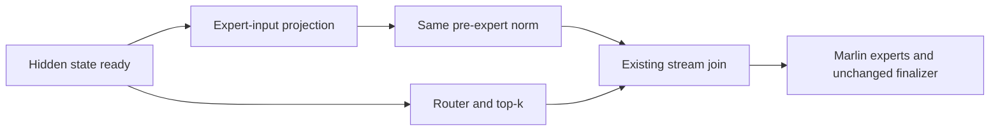

# Marlin pre-expert normalization overlap

Status: source-confirmed experiment design only. No new submission diff,
native run, numerical pass or speedup. This is an application of established
dataflow/stream overlap, not a claim of historical novelty.

## Existing dependency graph

At official base 297e54fd, `models/muse_spark.py::_forward_experts` records the
side-stream dependency before enqueuing the expert-input projection. Router
and top-k run on the side stream. Main then waits for that stream and calls
the experts. Packed early-input preparation excludes `use_marlin`.

`muse_spark_fp4_moe.py::_forward_marlin` subsequently applies
`pre_expert_norm` before the two GEMMs. Thus the current Marlin normalization
is after the router join even though its input is the expert projection, not
the routing result. The baseline already permits projection/router overlap;
actual concurrent execution has not been measured.

Proposed dependency graph:

The present graph puts the join before normalization. The proposed order
allows normalization to use remaining router slack on the main stream.

## Minimal future change

After enqueuing router/top-k and before the main-stream wait, apply the exact
same pre-expert norm to `expert_input` on main when all of these hold: CUDA,
NVFP4, Marlin, no sequence-parallel path, and a norm is present. Pass `None`
as the later pre-norm argument only for that call. Other paths retain their
current argument and behavior. No kernel arithmetic, collective, weight or
precision change is proposed.

The inspected RMSNorm implementations return new tensors rather than mutating
the shared hidden state. That supports the dependency argument, but must be
verified against the actual norm instance and installed image. Do not infer
alias safety from the module name alone. Preserve existing stream events,
tensor lifetime/recording and captured graph boundaries; add no host data read.

## Ideal bound and why it can lose

Let P be projection duration, R the complete router/top-k branch duration and
N normalization duration from a common ready event. Ignoring interference:

`current = max(P,R) + N`

`proposed = max(P+N,R)`

`ideal saving = min(N, max(0,R-P))`.

If routing has already finished by the projection, the bound is zero. This
change can lose when the extra concurrency slows routing through shared
bandwidth/SM pressure or increases capture/host overhead. The formula holds
only when phase durations remain fixed; it is not a promised speedup.

## Experiment that resolves it

Profile P/R/N on common event timelines at the four loads, real graph buckets
and representative contexts. Check that the norm runs exactly once and has
the same input/weight/epsilon/output dtype. Compare fresh route IDs, masked
inactive experts, both norm forms and growing/shrinking graph buckets against
stock. Validate capture/replay, input immutability and allocator lifetimes.

Measure paired whole-MoE latency with normalization in its original location
and before the join. Keep original projection/router implementations and
parameters. Record rank maxima and both branch timings to expose contention;
a faster norm kernel with slower MoE completion is a failed experiment.
Only a native win should advance to full-model answer/TTFT/all-load checks.

Evidence: CONCEPT_LOCAL_SOURCE_AUDIT_2026-11-10.json records exact official
source hashes and read scope. CUDA's documented overlap semantics explain
why readiness matters; this design uses the existing streams and does not
require turning on PDL. [CUDA synchronization/PDL reference](https://docs.nvidia.com/cuda/cuda-programming-guide/04-special-topics/programmatic-dependent-launch.html).
